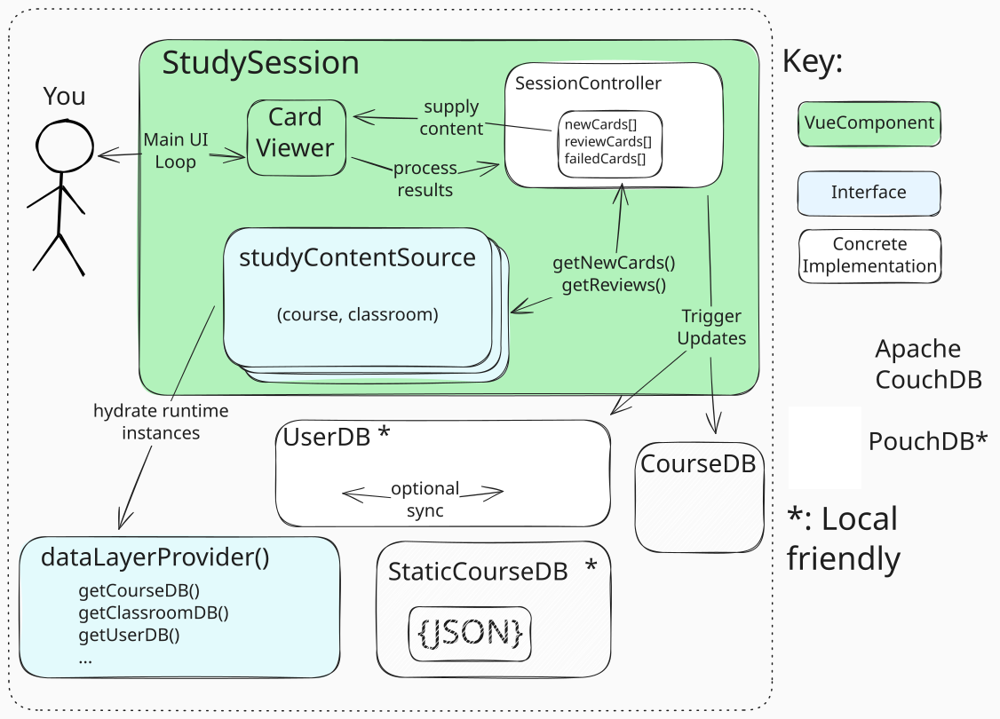
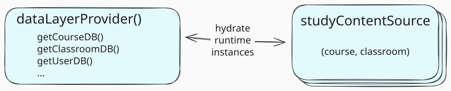
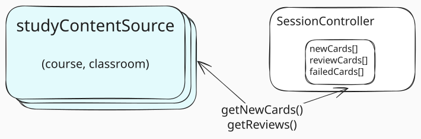

# The Big Picture



The focal point of `skuilder` is the study loop: show a card, take a response, update what we know
about the learner, choose the next card. The `StudySession.vue` component (in
`@vue-skuilder/common-ui`) renders it, and a `SessionController` (in `@vue-skuilder/db`) drives
it. If you ran the inline demo on the docs [frontpage](../index), you've seen this loop first-hand.

This page walks through the lifecycle of one session and names the major parts along the way. The
[Pedagogy](./pedagogy) page covers how cards are chosen in more depth.

::: warning !!!
The diagrams on this page are right in spirit but not *strictly* accurate in their named entities
or functions. In particular they predate the single supply queue described below.
:::

## The layers

| Layer | Package | Holds |
|---|---|---|
| Shared types | `@vue-skuilder/common` | Data shapes, field types, `Evaluation`, ELO math, tag-filter types |
| Data and logic | `@vue-skuilder/db` | Data-layer interfaces and their CouchDB and static implementations, the navigation pipeline, `SessionController`, SRS and ELO services. No Vue |
| Components | `@vue-skuilder/common-ui` | `StudySession`, card rendering, the `Question` base class, view composables |
| Card types | `@vue-skuilder/courseware` | The `CourseWare` registry and built-in card types (fill-in, math, chess, piano, typing, ...) |
| Apps | `standalone-ui`, `platform-ui`, `studio-ui` | Application shells (see [Application Types](./apps)) |
| Tools | `cli`, `express`, `mcp` | Scaffolding and course packing, the backend API, the agent interface |

`@vue-skuilder/db` runs in Node as well as the browser. Scheduling and card selection do not depend
on Vue.

## Session Startup

### Configuration

Before the loop begins, the app hands `StudySession` a few things:

- a list of content sources: the courses (or classrooms) to draw from, as `ContentSourceID`s;
- a time limit, in minutes;
- the user, the data layer, and a `getViewComponent` function that turns a card's view ID into a
  Vue component (usually `allCourseWare.getView`);
- an optional `StudySessionConfig`: confetti, batch size, session-wide hints, outcome observers.

In the frontpage demo the content source is hard-coded. An app with a single standalone course
would hard-code its course too. In more general contexts the sources come from a learner's
registrations or a menu.

```ts
interface ContentSourceID {
  type: 'course' | 'classroom';
  id: string;
  tagFilter?: TagFilter; // study only cards carrying some tags (CouchDB data layer only, for now)
}
```

### Initialization

Each `ContentSourceID` is resolved to a `StudyContentSource` with `getStudySource(source, user)`.
For a course, the source is the course database itself. Its whole job is to return scored
candidates:

<<< @../../packages/db/src/core/interfaces/contentSource.ts#docs_StudyContentSource

We're here:



### Session Planning

To plan, the `SessionController` asks each source for weighted cards. Behind
`getWeightedCards()`, the course runs its **navigation pipeline**: generators propose candidates
(new cards near the learner's level, due reviews, authored targets), filters gate or reweight them,
and regulators balance new material against review backlog. Each result is a `WeightedCard`: a card
ID, a score, and a provenance trail saying how the score was reached.

New cards and reviews come back on one scale and in one ranking. The controller puts them, in rank
order, into a single **supply queue**. When there are several sources, a mixer interleaves them.

The default behaviour keeps some new material flowing every session while trading off session
length against review backlog. Review due dates mean *eligible*, not *overdue*: the system keeps a
buffer of eligible reviews so that a missed day doesn't snowball.



## The Main Loop

The session enters its main loop: present a card, capture the response, update state, repeat.

### Card Presentation

The controller holds two queues:

| Queue | Contents | Refilled by |
|-------|----------|-------------|
| **Supply** | New cards and reviews, in pipeline rank order | Replans: re-runs of the pipeline mid-session |
| **Failed** | Cards missed this session | Wrong answers |

Normally the next card is the head of the supply queue. A failed card is interleaved every few
draws, so remediation is spaced out rather than piled up at the end. Near the end of the session,
failed cards take priority.

The chosen card is **hydrated**: its data documents are fetched, its `Question` class is
instantiated with that data, and its Vue view is rendered.

### Response Capture

The view collects the learner's answer and submits it. The card's `Question` evaluates it:

```ts
interface Evaluation {
  isCorrect: boolean;       // SRS: extend or reset the interval
  performance: Performance; // ELO: how well, 0-1, optionally per tag
  fluent?: boolean;         // false: correct but too slow
  deferAdvance?: boolean;   // record now, advance when the view says so
}
```

The evaluation, the answer, and the time spent become a `CardRecord`.

### State Updates

The record is written to the learner's history, then processed:

1. **ELO**: on the first attempt at a card in a presentation, both the learner's and the card's
   ratings move, globally and on each graded tag.
2. **SRS**: a correct first attempt schedules the next review. Cards tagged `srs:skip` (for example,
   one-time introductions) are never scheduled.
3. **Retries and remediation**: a wrong answer can be retried in place, up to a limit. After that
   the card goes to the failed queue for later in the session.
4. **Replanning**: when the supply queue runs low, or holds few well-indicated cards, the controller
   re-runs the pipeline in the background. Card views can also request a replan with hints (for
   example, "boost practice on the concept just introduced").

### Loop Continuation

The loop continues until the time limit is reached and the failed queue is empty, or the learner
ends the session.

## Cleanup

As the session approaches its time limit, the controller shifts toward finishing cleanly.

- With under two seconds left and nothing failed, it won't start a new card.
- Once time is up, only failed cards are served, and the session ends when they're cleared.
- A replan can ask for a minimum number of follow-up cards. That holds the session open past the
  timer, so an introduction near the end still gets its practice.

### The Failed-Card Guarantee

A core invariant: **failed cards must be cleared before session end.**

If a card was failed during the session, the learner must complete it before leaving. This ensures:
- the learner doesn't exit with unresolved confusion;
- failed concepts get immediate reinforcement;
- the SRS schedule reflects actual mastery, not abandonment.

### Session Completion

When the session ends:

1. A `StudySessionDoc` is saved to the learner's database: what was shown, a summary of each
   pipeline run (selected cards, near misses, regulator readings), the ELO changes, and app and
   content version stamps.
2. The view yields to a summary (or whatever the app puts in the `session-finished` slot).

The learner's progress is persisted. The next session picks up where this one left off, with the
SRS schedule and ratings reflecting everything that happened.

## Key Interfaces

The architecture is held together by a few contracts:

```ts
// A scored candidate, with an audit trail
interface WeightedCard {
  cardId: string;
  courseId: string;
  score: number;                       // suitability, usually 0-1
  provenance: StrategyContribution[];  // what each pipeline stage did to it
  reviewID?: string;                   // present for reviews
}

// What a question's grading produces
type Performance = number | TaggedPerformance;
interface TaggedPerformance {
  _global: number;                     // [0, 1]
  [tag: string]: number | null;        // per-tag score, or null for count-only
}
```

- **Card types** plug in through `Question` subclasses and Vue views
  ([Creating Custom Cards](../extend/custom-cards)).
- **Pedagogy** plugs in through generators and filters
  ([Navigation Strategies](../extend/navigation-strategies)).
- **Storage** plugs in through the data-layer interfaces ([Data Layer](./data-layer)).
- **Apps** steer a session through `StudySessionConfig`: session-wide hints, outcome observers
  that react to each response, and replans requested from card views.

## Going deeper

The framework's internal docs describe the same machinery at source level:

- [session-lifecycle-and-replan.md](https://github.com/patched-network/vue-skuilder/blob/master/packages/db/docs/session-lifecycle-and-replan.md):
  how `SessionController` plans, draws, replans, and where apps hook in
- [navigators-architecture.md](https://github.com/patched-network/vue-skuilder/blob/master/packages/db/docs/navigators-architecture.md):
  the pipeline itself
