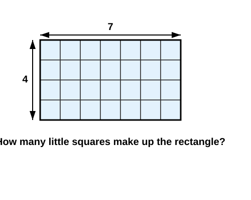

# Cards: The Unit of Study

::: tip Reading order
You need this background if you want to build custom card types or custom pedagogical logic. On a
first read, you may prefer to skip ahead to the [Default Card Type](./cards). For a hands-on
treatment, see [Creating Custom Cards](../extend/custom-cards).
:::

**Cards are the atomic unit of learning content.** Each card represents a single pedagogical
interaction: a question to answer, a passage to read, a skill to practice.

In particular, a single card is typically **the rendered thing** with which a user interacts.

In the database, a card is metadata that references its constituent parts:

```typescript
interface CardData {
  docType: DocType.CARD;
  id_displayable_data: DocumentId[]; // one or more data documents
  id_view: DocumentId;               // which view renders it, e.g. "default.question.BlanksCard.FillInView"
  elo: CourseElo;                    // difficulty, globally and per tag
  author: string;
}
```

Tags are separate documents that list the cards they apply to. A view ID names the courseware, the
question class, and the view component:
`{courseware}.question.{QuestionClass}.{ViewName}`.

## The Card Lifecycle

When a learner encounters a card, the system performs **card hydration**, then grading:

1. **Fetch data**: retrieve the referenced data documents.
2. **Convert format**: turn them into `ViewData` (plain objects with typed field values).
3. **Instantiate question**: create the `Question` subclass named by the view ID, with that data.
4. **Render view**: display the Vue component named by the view ID.
5. **Capture response**: the view submits the learner's answer and the time spent.
6. **Evaluate**: the question's `evaluate()` produces an `Evaluation`.
7. **Update pedagogy**: ELO ratings move, and the next review is scheduled.

# Core Components

## 1. DataShapes: schema definitions

A `DataShape` defines the structure of the data that can populate a card:

```typescript
interface DataShape {
  name: DataShapeName;
  fields: FieldDefinition[];
}
```

Each field has a `name`, a `type` (from the `FieldType` enum), and optional validators and
taggers. Field types:
- Primitives: `STRING`, `NUMBER`, `INT`
- Content: `MARKDOWN`, `IMAGE`, `AUDIO`, `MIDI`
- Specialized: `CHESS_PUZZLE`, `MEDIA_UPLOADS`

**Example**: single-digit addition

```typescript
{
  name: DataShapeName.MATH_SingleDigitAddition,
  fields: [
    { name: 'a', type: FieldType.INT },
    { name: 'b', type: FieldType.INT }
  ]
}
```

Data shapes are registered in the course's configuration, which also stores each one as a JSON
schema. Authoring tools (the studio editor, the MCP server) use that schema to validate new cards.

## 2. Questions: the grading layer

The abstract `Question` class (which extends `Displayable`) defines how to:
1. **interpret** data into an interactive experience;
2. **judge** a response as correct or not;
3. **score** the demonstrated skill.

```typescript
abstract class Question extends Displayable {
  static dataShapes: DataShape[];
  static views: ViewComponent[];

  protected abstract isCorrect(answer: Answer): boolean;
  protected displayedSkill(answer: Answer, timeSpent: number): number; // default: correctness × a speed penalty
  public evaluate(answer: Answer, timeSpent: number): Evaluation;
}

interface Evaluation {
  isCorrect: boolean;       // SRS: extend or reset the interval
  performance: Performance; // ELO: a number in [0, 1], or per-tag scores
  fluent?: boolean;         // false: correct but too slow; SRS caps the next interval
  deferAdvance?: boolean;   // record now, advance when the view emits ready-to-advance
}
```

Questions declare:
- which `DataShape`s they consume;
- which Vue components can render them;
- how to judge correctness;
- (optionally) how to score performance, including per-tag scores. Override `evaluate()` to
  return a `TaggedPerformance` such as
  `{ _global: 0.67, 'letter-c': 0, 'letter-a': 1, 'letter-t': 1 }`, and each tag's rating moves
  on its own.

**Example**: `SingleDigitAdditionQuestion` consumes data matching the single-digit-addition shape
and can render via `HorizontalAddition` or `VerbalAddition` (see
`packages/courseware/src/math/questions/addition/`).

A question type can also ship its own content. `static seedData` supplies data items (for example,
every pair from 0+0 to 9+9), `static seedMeta` gives each item tags and a starting ELO, and
`acceptsUserData = false` marks the seed set as complete. Seeded cards are created when the question
type is registered with a course.

## 3. Views: the presentation layer

Views are Vue components. A view receives the card's data, builds its `Question`, renders whatever
it likes, and submits the learner's answer through the `useViewable` / `useQuestionView`
composables. A `Displayable` that isn't a `Question` (an information card) is simply dismissed.

# Design Goals

## Flexible Rendering

A single `DataShape` can have multiple views:
- `SingleDigitAddition`::`HorizontalAddition` (symbolic: "7 + 4 = ?")
- `SingleDigitAddition`::`VerbalAddition` (natural language: "What is seven plus four?")

Different views of the same content:
- give a more robust signal of competence;
- avoid 'overfitting' a skill to one presentation;
- permit some kinds of explicit scaffolding.

For example, a canned sequence of renderings of a basic multiplication fact can reinforce the
relationship between multiplication and the area of a rectangle.

The 'normal' view:

`4 x 7 = __`

Followed directly by:



## Skills Graded by the Card

A card can report how a response went on each skill it exercises, rather than one number for the
whole card. A spelling card can mark one letter wrong and the rest right; a chord card can grade
pitch and rhythm separately. Each tagged skill keeps its own rating for the learner and for the
card, and selection can then lean toward a learner's weakest skills
(see [Pedagogy](./pedagogy#per-skill-selection)).

## Compositional Questions (direction)

The longer-term aim is for questions to compose. For example, the stacked addition question

<pre>
  123
+ 456
-----
</pre>

could execute as a sequence of `SingleDigitAdditionQuestion` instances, each evaluated on its own
merits. Prerequisites and credit would then follow from the structure of the questions ("by the
compiler") rather than being hand-built by a curriculum author: completing the stacked question
counts as practice on its single-digit parts, and mastery of those parts can gate the three-digit
question.

Today, per-tag grading carries the credit part of this by hand (the card author names the tags it
grades), and the hierarchy filter carries the gating part. Automatic composition is not built.
