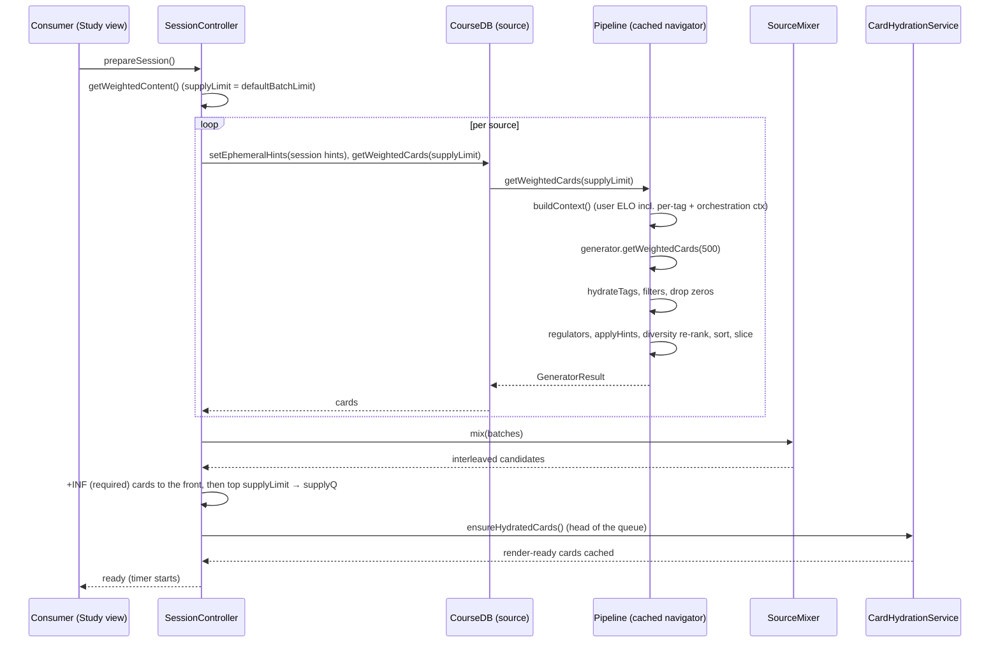
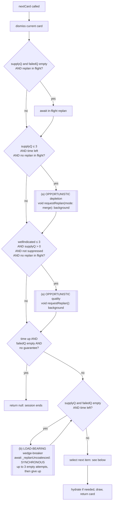
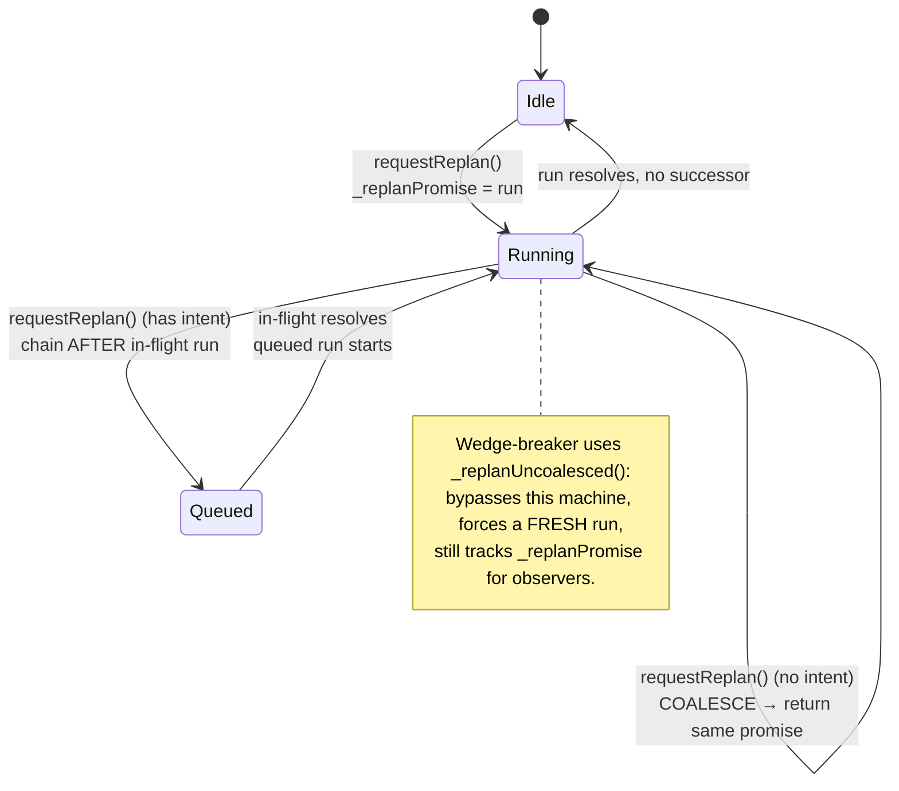

# Session Lifecycle & Replanning (as-built)

> **Status:** Descriptive map of current behavior, for theory-building and review.
> Updated 2026-11-18 for the single supply queue (landed 2026-06, `4b93b754`). The core sections (Cast →
> Consumer extension points) are consumer-agnostic and framework-doc-ready. The
> final **Performance notes** section is living, internal/diagnostic commentary
> on the *current* implementation and should be trimmed before this ships as
> public framework documentation.
>
> **Perf status (2026-11).** The 2026-05 mid-session jank is resolved (cache
> work, below). The 2026-11 runtime-perf work resolved the course-DB side of
> session start: sessions bind to the local replica when one exists, and far
> fewer remote calls when one doesn't. Open: user-DB reads and main-thread work
> during replans (see *Open threads*).

This document maps how `SessionController` drives content selection through the
navigation `Pipeline` during a study session: what runs at session start, how
the next card is chosen, when the pipeline re-runs ("replans"), how concurrent
replans are reconciled, and where consumer applications hook in.

It is a companion to `navigators-architecture.md` (which describes the
generator/filter pipeline itself). This doc describes the *driver* around it.

---

## Cast

| Component | Role | Layer |
|-----------|------|-------|
| `SessionController` | Owns the session clock and two queues; decides what card is next; triggers replans | framework |
| `StudyContentSource` | A content source. Production impl is `CourseDB` (one per course in the session) | framework |
| `CourseDB.getWeightedCards()` | Runs the course's (cached) navigator | framework |
| `CourseDB.createNavigator()` | Reads strategy docs, assembles a `Pipeline`; cached ~5 min per user | framework |
| `Pipeline` | generate → hydrate tags → filters → drop zeros → regulators → hints → diversity re-rank → top N | framework |
| `SourceMixer` (`QuotaRoundRobinMixer`) | Interleaves candidates from multiple sources | framework |
| `CardHydrationService` | Turns selected items into render-ready cards (view component + data) | framework |
| Consumer card views | May call `requestReplan()` with hints (e.g. pedagogical intros) | **consumer** |

The two queues live on `SessionController`:

- **supplyQ**: new cards *and* reviews, in pipeline rank order. Reviews and new
  cards compete on one scale (the pipeline's regulator stage sets the balance),
  so there is no second new-vs-review mix in the controller. Drawn
  front-to-back; replaced, or merged into from the front, by replans.
- **failedQ**: cards missed this session, served as remediation (below).

(Before 2026-06 there were three queues: a reviewQ filled once at start and
never refilled, a newQ refilled by replans, and the failedQ. Older docs and
comments may still say so.)

---

## Two distinct pipeline entry points

Everything expensive happens inside `Pipeline.getWeightedCards()`. It is reached
two ways:

1. **Initial planning**: `prepareSession()` → `getWeightedContent()` once.
2. **Replan**: `requestReplan()` → `_runReplan()` → `getWeightedContent({replan:true})`, any number of times mid-session.

Both call `source.getWeightedCards(limit)` on every source. **There is no
separate "cheap" path**: a replan runs the same machinery as initial planning.

---

## Sequence: session start



Key parameters:

- `defaultBatchLimit` (constructor option, default **20**): the supply working
  set. Each source is asked for this many; the mixed result is capped at it,
  plus any required (`+INF`) cards, which are exempt from the cap.
- There is no separate review budget any more (the old `initialReviewCap` of
  200 is gone): reviews are ranked with new cards inside the working set.

---

## Sequence: serving a card (`nextCard`) and its replan triggers

`nextCard()` dismisses the current card, then runs the replan triggers before
drawing the next card:



### The trigger taxonomy (from the source comments)

- **(a) Opportunistic prefetch**: `depletion` (supplyQ ≤ `DEPLETION_PREFETCH_THRESHOLD`
  = 3; runs in `merge` mode so already-queued cards, e.g. an undrawn required
  follow-up, survive) and `quality` (`_wellIndicatedRemaining` ≤ 3, where
  well-indicated means a final score ≥ `WELL_INDICATED_SCORE` = 0.10).
  Fire-and-forget (`void`). Their job is to make replans happen *early*. **A
  missed opportunistic replan is acceptable**: it's a perf optimization.
- **(b) Load-bearing wedge-breaker**: if the clock is ticking and we'd serve
  `null`, the pipeline runs **synchronously** in the draw path. Bypasses
  coalescing. This is the only *correctness* guarantee. **A missed wedge-breaker
  is a stall/wedge.**

> Design rule from the code: *"a redundant pipeline run is a perf bug, a missing
> pipeline run is a correctness bug. Bias toward the cheaper failure."*

The user-perceptible **in-session pause** is the wedge-breaker firing
synchronously, i.e. the opportunistic prefetch already lost the race to the
user emptying the queue.

### Choosing the next item

`_selectNextItemToHydrate()`, in order:

1. Both queues empty: nothing (session over).
2. Under 2 s left, no failed cards, no guarantee: nothing (don't start a card
   that can't finish).
3. Timer expired, no guarantee: failed cards only, then end.
4. A card guarantee (`_minCardsGuarantee`) is active: the head of supplyQ, so
   remediation doesn't eat the guaranteed follow-ups.
5. **Failed interleave**: a failed card if either the remaining time minus the
   estimated cleanup time is ≤ 20 s (endgame), or 4 supply draws have passed
   since the last failed-queue event. A just-failed card resets that counter, so
   it gets spacing rather than an instant retry.
6. Otherwise the head of supplyQ; if supplyQ is empty, failedQ.

**Guarantee:** failed cards are cleared before the session ends. Past the timer
only remediation (and guaranteed follow-ups) are served.

---

## Replan lifecycle (concurrency state machine)

`requestReplan()` reconciles concurrent replans. The distinction that drives the
machine is **intent**: a bare auto-replan has no intent and may coalesce;
anything carrying scheduling-relevant options must not be dropped.



Has-intent test (`_replanHasIntent`): true if any of `limit`,
`minFollowUpCards`, a non-`replace` `mode`, non-empty `hints`, `sessionHints`
or `mergeSessionHints`. **`label` is not intent**: it is observability only
(overlay spinner, logs), so labelled auto-replans still coalesce.

### Side-effects a replan can set

| Flag / counter | Set by | Effect |
|----------------|--------|--------|
| `_suppressQualityReplan` | burst replan (`limit < defaultBatchLimit`) | mutes the (a)-quality trigger so a small hinted queue isn't clobbered before consumption; cleared by the depletion trigger |
| `_minCardsGuarantee` | replan with `minFollowUpCards` | timer cannot end the session until this many more cards are served; lets an intro near session end still get its follow-up |
| `_wellIndicatedRemaining` | every plan/replan | count of cards scoring ≥ 0.10; drives (a)-quality |
| session-durable hints | `sessionHints` (replace) / `mergeSessionHints` (merge) | merged into *every* later pipeline run this session, auto-replans and the wedge-breaker included |

### Auto-exclude on every replan

`_runReplan()` always excludes, via `hints.excludeCards`: the current card, every
card already in `_sessionRecord`, and `supplyQ.peek(0)` (the imminent draw). This
prevents the just-drawn / about-to-draw card from being re-seated at the head of
a freshly-replaced supplyQ and shown twice.

---

## Consumer extension points

This is where applications (e.g. LettersPractice) shape the session. The
framework surface is small:

1. **`SessionController.requestReplan(options)`**: request a mid-session replan.
   `ReplanOptions`: `hints` (one-shot), `sessionHints` / `mergeSessionHints`
   (session-durable), `limit`, `mode` (`replace` | `merge`),
   `minFollowUpCards`, `label`.
2. **`ReplanHints`** (forwarded to the pipeline, applied after filters and
   regulators): `boostTags`, `boostCards`, `requireTags`, `requireCards`,
   `excludeTags`, `excludeCards`. Tag/card patterns support `*` globs. When
   hints are merged, boosts multiply and lists concatenate.
3. **`source.setEphemeralHints()`**: how the controller threads hints to each
   source for the next run. `CourseDB` stashes them; `Pipeline` consumes and
   clears them after one run.

Hint application order in the pipeline (`applyHints`): **exclude → boost →
require**. `requireCards` is a hard guarantee: required cards are injected into
the result with `+Infinity` score even if a filter zeroed them, are pre-fetched
into the pool if the generator never produced them, and are floated to the
front of supplyQ exempt from its cap.

### Worked example: LettersPractice GPC intro

When a phonics intro card completes, the consumer view fires a replan
(`buildIntroReplanRequest`, LP `src/services/sessionManagement/introReplan.ts`):

```ts
{
  label,
  mergeSessionHints: {
    boostTags: {
      [practiceTag]: INTRO_EXERCISE_BOOST,       // push the matching exercise
      'gpc:intro:*': INTRO_DISCOURAGE_FACTOR,    // discourage another intro, durably
    },
    requireCards: followUpCards,                 // guarantee the follow-up cards
  },
  hints: { excludeTags: ['gpc:intro:*'] },       // no intro in this very run
  minFollowUpCards: 2,  // guarantee 2 cards even if the timer is nearly up
}
```

What each part does:

- `mergeSessionHints` → the boost and the requirement survive the depletion and
  quality auto-replans that follow, and accumulate with an earlier intro's
  emphasis in the same session instead of replacing it.
- `requireCards` → the follow-up is force-injected even if filters or ELO
  wouldn't have ranked it.
- `minFollowUpCards: 2` → sets `_minCardsGuarantee`, so the intro's practice
  is shown rather than the session ending on the intro.
- No `limit` / `mode`: a full re-rank in `replace` mode. An earlier version
  used a `limit: 3` burst, which with a single supply queue would cut the
  whole queue, reviews included, to 3 cards.

It is submitted *before* the intro animation plays out, to hide pipeline
latency behind animation time.

### Best practices for consumers

- **Submit and replan _early_, behind cover.** Fire `requestReplan()` as soon as
  intent is known (e.g. on card submit, before an animation finishes) so the
  pipeline runs during otherwise-idle time.
- **Treat opportunistic replans as best-effort.** A missed `(a)` prefetch is a
  perf hiccup, not a bug. Never encode correctness ("this card _must_ appear") in
  a bare auto-replan: it can be silently coalesced. Carry **intent** (`limit`,
  `hints`, session hints, `minFollowUpCards`; not just a `label`).
- **Use session hints for emphasis that should outlive one run.** A one-shot
  `hints` boost is gone by the next auto-replan. `mergeSessionHints` accumulates
  (boosts multiply, so clamp if you may re-boost the same tag);
  `sessionHints` replaces.
- **Use `requireCards` for hard guarantees, not `boostTags`.** Boosts only bias
  ranking; `requireCards` force-injects with `+Infinity` even past a zeroing
  filter.
- **Guard end-of-session intros with `minFollowUpCards`.** A late intro card
  without a follow-up guarantee can end the session on the intro itself.
- **Don't burst with a small `limit` lightly.** The supply queue holds reviews
  too, so a `replace` replan with `limit: 3` shrinks the whole working set. It
  also doesn't save work: the pipeline still scores ~500 candidates.
- **Don't replan per keystroke/answer.** Replans coalesce but aren't free; lean
  on the built-in depletion/quality triggers for routine refills.

---

## Performance notes (living — internal/diagnostic; trim for public framework doc)

> Folds in the former `session-pipeline-perf` living assessment. Observations
> about the *current* implementation; diagnostic, not part of the stable design.
> Snapshot: 2026-05.

### Resolved: the felt mid-session jank

The reported symptom was UX jank — pauses once the session queues bottomed out.
Root cause: the **synchronous wedge-breaker** (see the `nextCard` trigger
taxonomy) firing in the draw path because the *background* replan lost the
consumption race. The opportunistic prefetch couldn't keep ahead because every
pipeline run was cold (caches defeated, hotspot below). Three changes closed it:

| Fix | Commit | Effect |
|-----|--------|--------|
| ELO-pool session cache in `getCardsCenteredAtELO` (fetch the broad neighbor pool once, re-rank in memory against the live ELO) | `b43dec1d` | recenter **2621ms -> 14ms** |
| Cache the constructed navigator (`_getCachedNavigator`) so the `Pipeline` instance — and its `_tagCache` / `_cachedOrchestration` — persist across replans | `1a0b1e0b` | retires "every run is cold" |
| Score from the pooled `c.elo`; delete the redundant `getCardEloData()` 500-doc `allDocs` | `e79bf619` | ~330ms off every ELOgen |

These shortened the warm replan (~2.6s) enough that it wins the race against
consumption. Observed sessions now report `wedgeRuns=0 awaitedReplan=false`. The
wedge path stays as the correctness backstop, but is rare-to-absent under normal
pace.

> **Caveat — not fully proven.** This is confirmed by jank-free logs, but we have
> not yet captured a *normal-pace* session with `wedgeRuns>0` to study the
> remaining trigger (or confirm it never fires). Don't re-optimize the wedge path
> on the assumption it's still hot; do capture such a log before declaring it
> closed for good.

### The two clocks (a mental model worth keeping)

Latency is only *felt* in proportion to whether the user waits on it. Every stage
sits on one of two clocks:

- **Blocking clock — felt 1:1.** User is staring at the screen with nothing to do.
  Cold first plan / spin-up, first-card hydrate, and the wedge-breaker *when it
  fires*.
- **Race clock — felt only past a budget.** Runs ahead of the user; absolute
  latency is invisible until it exceeds its slack. Background replan (deep slack
  ~ 3-card depletion lead), background hydration (thin slack), already-hydrated
  `nextCard` draws (trivial).

| Stage | Cost | Clock | Slack | How felt |
|-------|------|-------|-------|----------|
| Cold spin-up (ELO reindex ~2.5s of it) | ~4.6s | **Blocking** | none | **1:1, maximal** |
| Background hydration | 1-2s/card | Race | thin | at the margin |
| Background replan | ~2.6s | Race | deep (~3 cards) | rarely felt |

The cache work above optimized the *least* time-sensitive stage (background
replan) — correctly, since that is what keeps us out of the wedge. The *most*
time-sensitive stage, cold spin-up, was the 2026-11 work's target (next
section); the figures in this table are 2026-05's.

### Course-DB reads: local vs remote (resolved 2026-11)

The 2026-05 notes suspected session reads were going to remote CouchDB instead of
the synced replica. Confirmed, and fixed for the course DB (fw #1197, 0.2.37):

- **Replica ready at load.** `CourseSyncService` writes `_local/sync-complete`
  when a sync finishes; on later page loads `ensureSynced` hands out the on-disk
  replica at once from that marker and refreshes it in the background (an
  epoch mismatch only drops the marker; the next load rebuilds).
- **Rebinding between sessions.** `PouchDataLayerProvider` keeps one `CourseDB`
  per course and replaces it when the replica becomes ready, so the *next*
  session on the same page reads locally. A running session keeps the handle it
  was built with (`CourseDB` still binds at construction).
- **Fewer remote calls without a replica:** one memoized remote handle per
  course with `skip_setup`, `CourseConfig` cached, tag stubs and applied tags
  read through `CourseDB.db` (local when available), strategy docs fetched once.
  Cold preparation went from ~21 requests to 10; with a replica, 2.

Production (2026-11-06): cold guest preparation 8.7 s → 3.6 s (remote, mobile
network); returning device 2.5 s, bound local. Whether a session ran local is
now visible: `sk:pipeline-run`'s `binding` (below).

### Open threads

- **User-DB reads.** A replan's generators used to scan the user's scheduled
  cards three times (`getActiveCards` from ELO and Prescribed,
  `getReviewstoDate` from SRS); they now share one in-flight scan
  (`BaseUserDB.scanScheduledCards`, 2026-11). It still reads the remote handle
  for a logged-in user: scheduled reviews are written to the server and reach
  the local mirror by live sync, so a local read could return a review that was
  just completed. Reading locally would need writes to land locally first. The
  remote range also accumulates tombstones (one per completed review), which
  the scan walks until compaction.
- **Main-thread work during replans** (filters, tag hydration, scoring) on
  slower devices. Yield points between stages are the cheap first step;
  attribute with a real-device trace first.
- **A session can't start before its first plan.** Preparation (~2.5–4 s)
  starts when `StudySession.vue` mounts. Consumers with a lead-in (a lesson, a
  hub) could prepare a `SessionController` earlier and hand it in; no seam for
  that yet.
- **First sync on a new device** (download, IndexedDB writes, view warming)
  runs on the main thread, alongside whatever session starts meanwhile.

### Still-true structural notes

1. **Every pipeline run *was* cold (RESOLVED by `1a0b1e0b`).** `getWeightedCards`
   used to call `createNavigator(user)` per invocation, building a new `Pipeline`
   with empty `_cachedOrchestration` / `_tagCache` every time. The cached
   navigator now preserves both across replans within a session.
2. **`fetchLimit` is hardcoded to 500 regardless of `limit`.**
   `Pipeline.getWeightedCards(limit)` always pulls ~500 candidates, hydrates
   their tags, and runs every filter over all 500, slicing to `limit` only at the
   end. A `limit: 3` burst does the same heavy work as a full plan.
3. **Initial fetch inflation (RESOLVED).** The initial plan used to ask each
   source for ~220 (`defaultBatchLimit + initialReviewCap`) to fill a separate
   review queue. With the single supply queue it asks for `defaultBatchLimit`.

### Instrumentation

**Timing marks (stable, shipped; fw #1198).** User Timing entries that tools
read with `performance.getEntriesByType('mark' | 'measure')` or Lighthouse's
`user-timings`:

| Name | Where | Detail |
|------|-------|--------|
| `sk:session-prepare-start`, `sk:session-prepared`, measure `sk:session-prepare` | `SessionController.prepareSession` | — |
| measure `sk:pipeline-run` (every run) | `Pipeline.getWeightedCards` | stage ms; `binding`: `local` / `remote` / `unknown` (`CourseDBInterface.readsLocal`) |
| `sk:course-sync-replicated`, `sk:course-sync-ready`, `sk:course-sync-refreshed` | `CourseSyncService` | `ready`'s `from`: `marker` / `sync` |
| `sk:first-card` | common-ui `StudySession` | card ID |

Helpers: `perfMark` / `perfMeasure` (`db/src/util/perfMarks.ts`), which never
throw.

**Parked logs.** The `[perf]` timing logs across `Pipeline`, `SessionController`,
`CardHydrationService`, `elo`/`srs` generators, and `courseDB` are commented out
in place — search **`[perf] parked`**. Uncomment to re-measure. The
`[Pipeline:timing]` summary line stays. Two provenance fields on the `nextCard`
log — `awaitedReplan` and `wedgeRuns` — are the instruments to re-enable first if
the wedge question is revisited.

## File reference

| File | Relevant region |
|------|-----------------|
| `db/src/study/SessionController.ts` | supplyQ / failedQ, `getWeightedContent`, `requestReplan`, `_runReplan`, `nextCard` triggers, `_selectNextItemToHydrate`, wedge-breaker |
| `db/src/impl/couch/courseDB.ts` | `getWeightedCards`, `setEphemeralHints`, `createNavigator`, `readsLocal` |
| `db/src/core/navigators/Pipeline.ts` | `getWeightedCards` (fetchLimit=500), `regulate`, `applyHints`, `hydrateTags`, `buildContext` |
| `db/src/core/navigators/generators/types.ts` | `ReplanHints`, `GeneratorResult` |
| `db/src/study/SourceMixer.ts` | `QuotaRoundRobinMixer` |
| `db/src/study/services/CardHydrationService.ts` | render-ready card cache |
| `db/src/study/SessionDebugger.ts` | per-draw / per-replan queue snapshots |
| consumer (LP): `src/services/sessionManagement/introReplan.ts` | intro replan example (`buildIntroReplanRequest`) |
| consumer (LP): `src/services/lessons.ts` | `getPostLessonHints()` |
